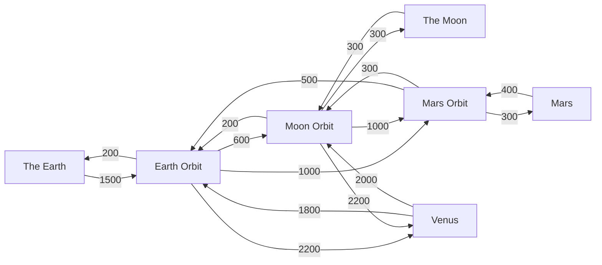

# Planets and Travel

Creating Space adds six worlds and gives the Overworld a travel role too. Every trip has a fixed **Δv cost** (the velocity change your rocket has to be able to deliver) and every world has its own gravity and arrival height.

| World | In-game name | Kind | Gravity | You arrive at | Orbits around | Page |
|---|---|---|---|---|---|---|
| Overworld | The Earth | Surface | 9.81 m/s² | Y 200 | n/a | n/a |
| Earth Orbit | Earth Orbit | Orbit | 0 | Y 64 | The Earth | [Orbits](Orbits-and-Space-Stations.md) |
| The Moon | The Moon | Surface | 1.6 m/s² | Y 300 | The Earth | [The Moon](The-Moon.md) |
| Moon Orbit | Moon Orbit | Orbit | 0 | Y 64 | The Moon | [Orbits](Orbits-and-Space-Stations.md) |
| Mars | Mars | Surface | 3.71 m/s² | Y 300 | the Sun | [Mars](Mars.md) |
| Mars Orbit | Mars Orbit | Orbit | 0 | Y 64 | Mars | [Orbits](Orbits-and-Space-Stations.md) |
| Venus | Venus | Surface | 8.87 m/s² | Y 300 | the Sun | [Venus](Venus.md) |

The Nether and the End are not part of the travel network.

## Delta-v map

These are the single-hop costs stored in the mod's data. Each arrow is **one direction**: going down costs differently from going up. For example, getting from the Earth to Earth Orbit costs 1 500 m/s but coming back costs only 200.

When you choose a destination that is not directly connected, the game finds the **cheapest route** and uses the total as the trip's cost. The rocket then flies it as a single burn (see [Launching and Flight](Launching-and-Flight.md)).

### Cost between any two worlds (m/s)

Read it as *from row, to column*.

| from \ to | The Earth | Earth Orbit | The Moon | Moon Orbit | Mars | Mars Orbit | Venus |
|---|---|---|---|---|---|---|---|
| **The Earth** | n/a | 1 500 | 2 400 | 2 100 | 2 800 | 2 500 | 3 700 |
| **Earth Orbit** | 200 | n/a | 900 | 600 | 1 300 | 1 000 | 2 200 |
| **The Moon** | 700 | 500 | n/a | 300 | 1 600 | 1 300 | 2 500 |
| **Moon Orbit** | 400 | 200 | 300 | n/a | 1 300 | 1 000 | 2 200 |
| **Mars** | 1 100 | 900 | 1 000 | 700 | n/a | 400 | 2 900 |
| **Mars Orbit** | 700 | 500 | 600 | 300 | 300 | n/a | 2 500 |
| **Venus** | 2 000 | 1 800 | 2 300 | 2 000 | 3 100 | 2 800 | n/a |

Examples: a rocket going from the Earth's surface to the Moon's surface needs 2 400 m/s of Δv (1 500 up to Earth Orbit, 600 on to Moon Orbit, 300 down to the Moon). The way back from the Moon's surface to the Earth costs 700.

> [!TIP]
> The cheapest "base camp" is an orbit station. Orbits connect cheaply to each other (Earth Orbit ↔ Moon Orbit is only 600 / 200), and you only pay the expensive 1 500 once, to get off the ground.

Costs come from the datapack registry `creatingspace:rocket_accessible_dimension`, so a modpack can change them; see [Datapack and Modpack Guide](Datapack-and-Modpack-Guide.md). Run `/creatingspace dumpGravityList` to see the gravity the server actually uses.

## Gravity

Gravity is not just a number on this page: it scales the real physics in each world.

- **Living entities, dropped items, boats, minecarts, falling blocks and primed TNT** fall with their normal gravity multiplied by *g ÷ 9.81*. On the Moon that is about one sixth.
- **Fall damage** is scaled by the same factor: the distance you fell is multiplied by *g ÷ 9.81* before damage is worked out.
- **Zero gravity (orbits):** nothing pulls you down. If you are airborne, holding **jump** accelerates you upwards and **sneaking** accelerates you downwards. You have to push against something or use these keys to move.
- A rocket's takeoff weight uses the gravity of the world it leaves, and its descent uses the gravity of the world it arrives at.
- Dimensions that are not in the travel table (the Nether, the End, other mods' worlds) use 9.81. The gravity effects are not applied in dimensions from the `ad_astra` and `ad_extendra` namespaces, so that those mods keep their own.

## Arrival

A rocket arriving in a world is placed at that world's **arrival height** (the Y column in the first table) at the X/Z you chose in the schedule, or the same X/Z it left from. If it is arriving at a surface it then falls until it touches ground. See [Launching and Flight](Launching-and-Flight.md#what-happens-during-a-flight).

## Odds and ends

- **Beds work** in every mod world. When the sleeping time passes, the change is applied to the Overworld's clock.
- **Skeletons** are the only creatures that spawn on the Moon, and the only mobs the oxygen rules leave alone; see [Life Support](Life-Support.md#who-is-affected).
